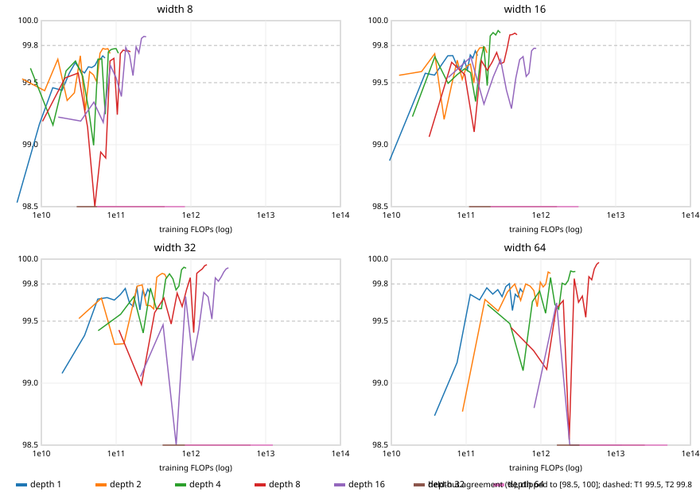

# Behaviour-cloning sweep over depth × width: model efficiency and training effort

**PARTIAL REPORT. The user stopped the run on 2026-10-10 at about 19:30 UTC; the Mac moved to the ducking-solver phase.** The spec is `research/prereg-bc-sweep.md`. This report covers only the work that finished. §7 lists what was not done. Executor: a mac-3 subagent, on main `9992a55` (core hash `0f329d4e3493…`). Raw data is in `/Users/kyle/Desktop/dino-game/runs/exp-bc-sweep/` (gitignored). Scripts are in `research/scripts/prereg-bc-sweep/`.

## 1. What was measured, and why it is time-independent
Every configuration `44-[w×d]-3` (d ∈ {1,2,4,8,16,32,64}, w ∈ {8,16,32,64}) was trained by behaviour cloning of `test/solver.js`. Training used `bc-train --backend python --snapshots --wasm`, with the shipped hyperparameters (15 epochs, batch 1024, lr 2e-3, cosine schedule, Adam), seed 1, and demos `runs/exp-bc-e2e` (seeds 1–40, 2,096,268 rows). The S2 candidates were also trained at seed 2.

Every primary number below is a count, or a deterministic function of (configuration, training seed, fixed data, fixed game seeds). That holds for parameters, MACs per decision, `model.js`/`model.css` bytes, training FLOPs, per-epoch held-out agreement, tier-A results (25 validation games to 1M) and tier-B results (1,000 games to 1M on seeds 30,003,000–30,003,999). None of them depends on wall-clock time or machine load. That is why up to 9 jobs could train in parallel, and why scans could run beside training. The only time-dependent figures are in the "Secondary" table, and nothing is ranked on them.

- **MACs per decision** = 44w + (d−1)w² + 3w. **Parameters** = MACs + d·w + 3.
- **Training FLOPs** = 6 × MACs × samples processed. The factor 6 is a standard approximation: 2 for the forward pass, 4 for the backward pass. Samples per epoch = floor(2,096,268 / 1024) × 1024 = 2,096,128.
- **Held-out agreement** is measured on `bc-gen` seeds 41–60, which are disjoint from the training seeds 1–40: 1,048,674 rows, default levels and spans. It is the row-weight-weighted fraction of frames where argmax(model) equals the solver's label. Recall is weighted the same way. It was computed on every epoch snapshot in float64 numpy (`agreement.py`). As a spot-check, `policy.js` argmax was recomputed on 3,005 rows per run: **0 mismatches in all 37 runs**.
- **Effort-to-criterion** is the first epoch whose snapshot reaches T1 = 99.5% or T2 = 99.8%, and the FLOPs up to that epoch. It is measured within one 15-epoch cosine schedule, not as a minimal budget.
- **T1/T2 positive control:** d2 w32 s1 reached T1 at epoch 1 and T2 at epoch 11, so T1 and T2 stay at 99.5% and 99.8%. The fallback rebase did not fire.

## 2. Premise checks (Step 0) and controls
- **Harness positive control:** the sweep's `d2-w32-s1` params (trained with `--snapshots`) are **bit-identical** to `runs/exp-bc-e2e/py-s1` (2,595/2,595 equal), and its epoch-15 snapshot equals `best.json`. The first STOP row did not fire.
- **Tier-B positive control:** `d2-w32-s1` scored **0/1,000** on the new seed range. The second STOP row did not fire.
- **Step 0.1 (shape-generic paths):** `bc-train --backend python`, `export --out <scratch>/model.js` and `trainer/css-model.js` handled d1 w8 and d64 w8, which were trained on tiny demos. Scratch copies of `index-css.html` evaluated both in headless Chrome. The pages passed their self-test, the model ids matched, and over ≥ 1,000 played frames plus 2,000 held-out demo rows there were **0 CSS/JS disagreements**. Caveat: the tiny-demo d64 w8 net outputs only "none", so the argmax machinery was exercised on both actions only for d1 w8 (201 jump decisions). No shape-specific problem was found. `export` needs the `--out` directory to exist already. CSS file sizes for all 28 configurations are in the table, up to 10.6 MB for d64 w64.
- **Step 0.2 (CSS recalc time per decision; headless Chrome, `performance.now()` around `cssDecide`, ≥ 3,000 played frames plus 2,000 back-to-back rows):** d2 w32 (the shipped `model.css`) took a median of **1.0 ms** (0.98 ms mean; back-to-back 1.00 ms). d2 w8 took a median of **0.2 ms** (0.25 ms mean; back-to-back 0.19 ms). That is about 5× faster, which rejects H-no-gain for speed (the bar was ≥ 1.5×). d1 w8 took 0.16 ms and d64 w8 2.3 ms (back-to-back). These are time-dependent measurements.
- **Step 0.3:** one d64 w64 epoch took 19.5 s CPU (2 threads), so training was not the bottleneck.

## 3. Results tables
### Per-configuration table (training seed 1; tier B seed 2 where run)

| d | w | params | MACs/decision | model.js B | model.css B | tier A | held-out agreement (ep 15) | recall none / jump | T1 epoch (FLOPs) | T2 epoch (FLOPs) | train FLOPs (15 ep) | tier B s1 | tier B s2 |
|---|---|---|---|---|---|---|---|---|---|---|---|---|---|
| 1 | 8 | 387 | 376 | 8,545 | 19,384 | 25/25 | 99.698% | 99.70% / 99.71% | 5 (2.36e10) | never | 7.09e10 | 0/1000 | 0/1000 |
| 2 | 8 | 459 | 440 | 10,033 | 22,840 | 25/25 | 99.735% | 99.74% / 99.69% | 1 (5.53e9) | never | 8.30e10 | 0/1000 | 0/1000 |
| 4 | 8 | 603 | 568 | 12,898 | 29,641 | 25/25 | 99.737% | 99.74% / 99.68% | 1 (7.14e9) | never | 1.07e11 | 0/1000 | 0/360 (incomplete) |
| 8 | 8 | 891 | 824 | 18,757 | 43,372 | 25/25 | 99.749% | 99.75% / 99.74% | 2 (2.07e10) | never | 1.55e11 | 2/1000 | — |
| 16 | 8 | 1,467 | 1,336 | 30,266 | 71,145 | 25/25 | 99.870% | 99.87% / 99.89% | 5 (8.40e10) | 13 (2.18e11) | 2.52e11 | 0/1000 | — |
| 32 | 8 | 2,619 | 2,360 | 53,492 | 127,156 | 0/25 | 88.908% | 100.00% / 0.00% | never | never | 4.45e11 | — | — |
| 64 | 8 | 4,923 | 4,408 | 100,472 | 239,672 | 0/25 | 88.908% | 100.00% / 0.00% | never | never | 8.32e11 | — | — |
| 1 | 16 | 771 | 752 | 16,385 | 33,781 | 25/25 | 99.718% | 99.71% / 99.75% | 3 (2.84e10) | never | 1.42e11 | 0/1000 | — |
| 2 | 16 | 1,043 | 1,008 | 21,861 | 45,350 | 25/25 | 99.741% | 99.75% / 99.68% | 1 (1.27e10) | never | 1.90e11 | 0/1000 | — |
| 4 | 16 | 1,587 | 1,520 | 32,758 | 68,431 | 25/25 | 99.902% | 99.90% / 99.90% | 2 (3.82e10) | 11 (2.10e11) | 2.87e11 | 0/1000 | — |
| 8 | 16 | 2,675 | 2,544 | 54,873 | 114,914 | 25/25 | 99.887% | 99.89% / 99.82% | 2 (6.40e10) | 12 (3.84e11) | 4.80e11 | 0/1000 | — |
| 16 | 16 | 4,851 | 4,592 | 99,130 | 209,714 | 25/25 | 99.777% | 99.78% / 99.77% | 1 (5.78e10) | never | 8.66e11 | 0/1000 | — |
| 32 | 16 | 9,203 | 8,688 | 187,885 | 400,566 | 0/25 | 88.908% | 100.00% / 0.00% | never | never | 1.64e12 | — | — |
| 64 | 16 | 17,907 | 16,880 | 364,957 | 781,799 | 0/25 | 88.908% | 100.00% / 0.00% | never | never | 3.18e12 | — | — |
| 1 | 32 | 1,539 | 1,504 | 31,932 | 62,465 | 25/25 | 99.728% | 99.72% / 99.77% | 3 (5.67e10) | never | 2.84e11 | 0/1000 | — |
| 2 | 32 | 2,595 | 2,528 | 53,080 | 104,521 | 25/25 | 99.843% | 99.84% / 99.84% | 1 (3.18e10) | 11 (3.50e11) | 4.77e11 | 0/1000 | — |
| 4 | 32 | 4,707 | 4,576 | 96,243 | 189,500 | 25/25 | 99.927% | 99.93% / 99.94% | 2 (1.15e11) | 8 (4.60e11) | 8.63e11 | 0/1000 | — |
| 8 | 32 | 8,931 | 8,672 | 182,292 | 359,181 | 25/25 | 99.955% | 99.96% / 99.95% | 3 (3.27e11) | 9 (9.82e11) | 1.64e12 | — | — |
| 16 | 32 | 17,379 | 16,864 | 354,279 | 705,120 | 25/25 | 99.930% | 99.93% / 99.90% | 4 (8.48e11) | 10 (2.12e12) | 3.18e12 | — | — |
| 32 | 32 | 34,275 | 33,248 | 700,691 | 1,403,485 | 0/25 | 88.908% | 100.00% / 0.00% | never | never | 6.27e12 | — | — |
| 64 | 32 | 68,067 | 66,016 | 1,389,984 | 2,796,650 | 0/25 | 88.908% | 100.00% / 0.00% | never | never | 1.25e13 | — | — |
| 1 | 64 | 3,075 | 3,008 | 63,199 | 120,004 | 25/25 | 99.735% | 99.73% / 99.74% | 3 (1.13e11) | 10 (3.78e11) | 5.67e11 | 0/1000 | — |
| 2 | 64 | 7,235 | 7,104 | 147,521 | 280,978 | 25/25 | 99.885% | 99.88% / 99.91% | 2 (1.79e11) | 11 (9.83e11) | 1.34e12 | — | — |
| 4 | 64 | 15,555 | 15,296 | 318,183 | 604,945 | 25/25 | 99.900% | 99.90% / 99.89% | 1 (1.92e11) | 7 (1.35e12) | 2.89e12 | — | — |
| 8 | 64 | 32,195 | 31,680 | 659,104 | 1,252,474 | 25/25 | 99.974% | 99.97% / 99.97% | 4 (1.59e12) | 7 (2.79e12) | 5.98e12 | — | — |
| 16 | 64 | 65,475 | 64,448 | 1,342,714 | 2,574,980 | 0/25 | 88.908% | 100.00% / 0.00% | 2 (1.62e12) | never | 1.22e13 | — | — |
| 32 | 64 | 132,035 | 129,984 | 2,713,683 | 5,239,966 | 0/25 | 88.908% | 100.00% / 0.00% | never | never | 2.45e13 | — | — |
| 64 | 64 | 265,155 | 261,056 | 5,453,789 | 10,568,104 | 0/25 | 88.908% | 100.00% / 0.00% | never | never | 4.92e13 | — | — |

### Seed-2 replicates (S2 candidates)

| config | tier A s2 | agreement s2 (ep 15) | T1 / T2 epoch s2 | tier B s2 | min margin s1 / s2 |
|---|---|---|---|---|---|
| d1 w8 | 25/25 | 99.701% | 4 / never | 0/1000 | 2.47e-5 / 5.48e-4 |
| d2 w8 | 25/25 | 99.736% | 4 / never | 0/1000 | 1.64e-4 / 9.92e-5 |
| d4 w8 | 25/25 | 99.741% | 3 / never | 0/360 (incomplete) | 2.11e-4 / 8.78e-4 |
| d1 w16 | 25/25 | 99.714% | 5 / never | — | 1.47e-4 / 5.76e-5 |
| d8 w8 | 25/25 | 99.760% | 2 / never | — | 6.60e-4 / 6.45e-5 |
| d2 w16 | 25/25 | 99.780% | 1 / 9 | — | 2.49e-4 / 8.31e-5 |
| d16 w8 | 25/25 | 99.800% | 1 / 12 | — | 5.23e-3 / 2.95e-3 |
| d1 w32 | 25/25 | 99.723% | 2 / never | — | 3.42e-4 / 8.38e-4 |
| d4 w16 | 25/25 | 99.838% | 2 / 11 | — | 3.04e-4 / 1.71e-4 |

### Learning curves: held-out agreement after each epoch (seed 1)

| config | FLOPs/epoch | ep1 | ep2 | ep3 | ep4 | ep5 | ep6 | ep7 | ep8 | ep9 | ep10 | ep11 | ep12 | ep13 | ep14 | ep15 |
|---|---|---|---|---|---|---|---|---|---|---|---|---|---|---|---|---|
| d1 w8 | 4.73e9 | 98.53 | 99.17 | 99.46 | 99.44 | 99.58 | 99.66 | 99.60 | 99.58 | 99.63 | 99.62 | 99.64 | 99.68 | 99.69 | 99.72 | 99.70 |
| d2 w8 | 5.53e9 | 99.53 | 99.44 | 99.69 | 99.36 | 99.42 | 99.72 | 99.28 | 99.59 | 99.56 | 99.50 | 99.74 | 99.78 | 99.77 | 99.77 | 99.74 |
| d4 w8 | 7.14e9 | 99.62 | 99.16 | 99.59 | 99.67 | 99.55 | 99.29 | 99.00 | 99.69 | 99.69 | 99.25 | 99.75 | 99.77 | 99.77 | 99.77 | 99.74 |
| d8 w8 | 1.04e10 | 99.19 | 99.54 | 99.58 | 99.14 | 98.24 | 98.94 | 98.89 | 99.67 | 99.70 | 99.24 | 99.73 | 99.76 | 99.76 | 99.76 | 99.75 |
| d16 w8 | 1.68e10 | 99.22 | 99.19 | 99.34 | 99.18 | 99.64 | 99.53 | 99.39 | 99.78 | 99.72 | 99.56 | 99.79 | 99.74 | 99.86 | 99.87 | 99.87 |
| d32 w8 | 2.97e10 | 88.91 | 88.91 | 88.91 | 88.91 | 88.91 | 88.91 | 88.91 | 88.91 | 88.91 | 88.91 | 88.91 | 88.91 | 88.91 | 88.91 | 88.91 |
| d64 w8 | 5.54e10 | 88.91 | 88.91 | 88.91 | 88.91 | 88.91 | 88.91 | 88.91 | 88.91 | 88.91 | 88.91 | 88.91 | 88.91 | 88.91 | 88.91 | 88.91 |
| d1 w16 | 9.46e9 | 98.87 | 99.31 | 99.58 | 99.56 | 99.65 | 99.72 | 99.72 | 99.64 | 99.60 | 99.68 | 99.60 | 99.72 | 99.70 | 99.76 | 99.72 |
| d2 w16 | 1.27e10 | 99.56 | 99.59 | 99.73 | 99.20 | 99.47 | 99.68 | 99.53 | 99.63 | 99.65 | 99.50 | 99.75 | 99.78 | 99.78 | 99.79 | 99.74 |
| d4 w16 | 1.91e10 | 99.23 | 99.71 | 99.50 | 99.57 | 99.61 | 99.58 | 99.35 | 99.64 | 99.79 | 99.48 | 99.88 | 99.90 | 99.88 | 99.92 | 99.90 |
| d8 w16 | 3.20e10 | 99.06 | 99.66 | 99.56 | 99.10 | 99.68 | 99.60 | 99.67 | 99.74 | 99.65 | 99.67 | 99.77 | 99.88 | 99.89 | 99.90 | 99.89 |
| d16 w16 | 5.78e10 | 99.54 | 99.71 | 99.33 | 99.55 | 99.69 | 99.44 | 99.29 | 99.54 | 99.69 | 99.71 | 99.55 | 99.58 | 99.76 | 99.78 | 99.78 |
| d32 w16 | 1.09e11 | 88.91 | 88.91 | 88.91 | 88.91 | 88.91 | 88.91 | 88.91 | 88.91 | 88.91 | 88.91 | 88.91 | 88.91 | 88.91 | 88.91 | 88.91 |
| d64 w16 | 2.12e11 | 88.91 | 88.91 | 88.91 | 88.91 | 88.91 | 88.91 | 88.91 | 88.91 | 88.91 | 88.91 | 88.91 | 88.91 | 88.91 | 88.91 | 88.91 |
| d1 w32 | 1.89e10 | 99.08 | 99.38 | 99.68 | 99.69 | 99.67 | 99.71 | 99.76 | 99.64 | 99.62 | 99.78 | 99.59 | 99.75 | 99.70 | 99.76 | 99.73 |
| d2 w32 | 3.18e10 | 99.52 | 99.69 | 99.31 | 99.32 | 99.57 | 99.78 | 99.79 | 99.63 | 99.62 | 99.60 | 99.85 | 99.87 | 99.88 | 99.88 | 99.84 |
| d4 w32 | 5.76e10 | 99.42 | 99.56 | 99.70 | 99.40 | 99.77 | 99.60 | 99.60 | 99.84 | 99.88 | 99.84 | 99.75 | 99.78 | 99.91 | 99.93 | 99.93 |
| d8 w32 | 1.09e11 | 99.43 | 98.99 | 99.57 | 99.69 | 99.48 | 99.73 | 99.62 | 99.75 | 99.85 | 99.41 | 99.88 | 99.91 | 99.92 | 99.95 | 99.96 |
| d16 w32 | 2.12e11 | 99.05 | 99.47 | 97.16 | 99.70 | 99.18 | 99.43 | 99.73 | 99.70 | 99.52 | 99.85 | 99.82 | 99.86 | 99.90 | 99.92 | 99.93 |
| d32 w32 | 4.18e11 | 88.91 | 88.91 | 88.91 | 88.91 | 88.91 | 88.91 | 88.91 | 88.91 | 88.91 | 88.91 | 88.91 | 88.91 | 88.91 | 88.91 | 88.91 |
| d64 w32 | 8.30e11 | 88.91 | 88.91 | 88.91 | 88.91 | 88.91 | 88.91 | 88.91 | 88.91 | 88.91 | 88.91 | 88.91 | 88.91 | 88.91 | 88.91 | 88.91 |
| d1 w64 | 3.78e10 | 98.74 | 99.17 | 99.72 | 99.67 | 99.77 | 99.72 | 99.75 | 99.70 | 99.78 | 99.80 | 99.59 | 99.72 | 99.70 | 99.76 | 99.73 |
| d2 w64 | 8.93e10 | 98.77 | 99.67 | 99.58 | 99.74 | 99.80 | 99.67 | 99.80 | 99.78 | 99.75 | 99.62 | 99.81 | 99.78 | 99.80 | 99.90 | 99.89 |
| d4 w64 | 1.92e11 | 99.63 | 99.48 | 99.10 | 99.66 | 99.74 | 99.56 | 99.85 | 99.63 | 99.60 | 99.81 | 99.79 | 99.83 | 99.90 | 99.90 | 99.90 |
| d8 w64 | 3.98e11 | 99.45 | 99.26 | 99.11 | 99.60 | 99.67 | 98.54 | 99.84 | 99.65 | 99.70 | 99.53 | 99.86 | 99.83 | 99.92 | 99.96 | 99.97 |
| d16 w64 | 8.11e11 | 98.80 | 99.65 | 88.91 | 88.91 | 88.91 | 88.91 | 88.91 | 88.91 | 88.91 | 88.91 | 88.91 | 88.91 | 88.91 | 88.91 | 88.91 |
| d32 w64 | 1.63e12 | 88.91 | 88.91 | 88.91 | 88.91 | 88.91 | 88.91 | 88.91 | 88.91 | 88.91 | 88.91 | 88.91 | 88.91 | 88.91 | 88.91 | 88.91 |
| d64 w64 | 3.28e12 | 88.91 | 88.91 | 88.91 | 88.91 | 88.91 | 88.91 | 88.91 | 88.91 | 88.91 | 88.91 | 88.91 | 88.91 | 88.91 | 88.91 | 88.91 |

### Secondary (time-dependent, measured under parallel load; not used to rank)

| config | train wall s | sum of epoch s | job CPU s (train + tier-A validation) | bench JS frames/s (sim + policy, 1 thread) |
|---|---|---|---|---|
| d1-w8-s1 | 32.0 | 30.8 | 54 | — |
| d1-w8-s2 | 25.3 | 24.3 | 55 |  |
| d2-w8-s1 | 42.6 | 41.4 | 63 | — |
| d2-w8-s2 | 28.8 | 27.9 | 62 |  |
| d4-w8-s1 | 51.5 | 50.4 | 77 | — |
| d4-w8-s2 | 36.6 | 35.7 | 77 |  |
| d8-w8-s1 | 70.2 | 69.1 | 106 | — |
| d8-w8-s2 | 52.3 | 51.4 | 107 |  |
| d16-w8-s1 | 44.7 | 43.6 | 158 | — |
| d16-w8-s2 | 81.7 | 80.7 | 163 |  |
| d32-w8-s1 | 95.3 | 94.2 | 78 | — |
| d64-w8-s1 | 235.7 | 234.7 | 150 | — |
| d1-w16-s1 | 36.2 | 34.9 | 60 | — |
| d1-w16-s2 | 27.8 | 26.9 | 60 |  |
| d2-w16-s1 | 42.8 | 41.7 | 73 | — |
| d2-w16-s2 | 33.0 | 32.2 | 73 |  |
| d4-w16-s1 | 53.3 | 52.3 | 98 | — |
| d4-w16-s2 | 42.9 | 42.1 | 98 |  |
| d8-w16-s1 | 62.8 | 62.1 | 149 | — |
| d16-w16-s1 | 51.9 | 50.7 | 244 | — |
| d32-w16-s1 | 120.3 | 119.1 | 90 | — |
| d64-w16-s1 | 198.4 | 197.7 | 178 | — |
| d1-w32-s1 | 38.5 | 37.2 | 74 | — |
| d1-w32-s2 | 32.3 | 31.3 | 73 |  |
| d2-w32-s1 | 14.7 | 14.4 | 72 | — |
| d4-w32-s1 | 24.5 | 23.5 | 144 | — |
| d8-w32-s1 | 38.2 | 37.1 | 262 | — |
| d16-w32-s1 | 124.8 | 124.1 | 471 | — |
| d32-w32-s1 | 156.3 | 155.6 | 142 | — |
| d64-w32-s1 | 298.4 | 297.7 | 264 | — |
| d1-w64-s1 | 34.9 | 34.3 | 103 | — |
| d2-w64-s1 | 23.1 | 22.0 | 158 | — |
| d4-w64-s1 | 39.4 | 38.2 | 319 | — |
| d8-w64-s1 | 86.9 | 86.1 | 600 | — |
| d16-w64-s1 | 141.6 | 141.0 | 132 | — |
| d32-w64-s1 | 271.2 | 270.5 | 250 | — |
| d64-w64-s1 | 539.2 | 538.3 | 492 | — |

The scans also include `d2-w32-s1`, the control (0/1,000). Tier-B cells marked "—" were not scanned. They are either outside the tier-B set (more than 5,056 MACs, or failed tier A), or seed-2 scans the stop prevented. `d4-w8-s2` was stopped after 360 of its 1,000 games, with 0 failures; that is not a tier-B result.

**Tier-B failures.** The only ones were `d8-w8-s1`, **2/1,000**: seed 30,003,071 at 47 points and seed 30,003,596 at 70 points. Both were the first small cactus, with the dino airborne after an early jump. `diag.js` found the following:
- the solver passes both seeds;
- one death is an in-distribution action error: one effective disagreement, a ground jump at frame 294 where the solver waits;
- the other is covariate shift: an early wrong jump at frame 252, then a second at frame 439.

Every other scanned configuration was 0/1,000 (one-sided 95% upper bound 0.30%).

## 4. Pareto frontiers (scanned configurations; seed 1 unless stated)
- **Reliability against MACs per decision.** Every scanned configuration except d8 w8 scored 0/1,000, so the frontier is a single point: **d1 w8 (376 MACs, 387 params), 0/1,000 on seed 1 and 0/1,000 on seed 2.** That is 0/2,000 over two training seeds, a one-sided 95% upper bound of 0.15%. d2 w8 (440 MACs) also scored 0/1,000 on both seeds. Nothing larger improves on these at this test's power.
- **Reliability against training FLOPs to T2.** Among the 0/1,000 configurations that reached T2, the cheapest was **d4 w16 (T2 at epoch 11, 2.10e11 FLOPs)**, then d16 w8 (2.18e11), d2 w32 (3.50e11), d1 w64 (3.78e11), d8 w16 (3.84e11) and d4 w32 (4.60e11).
  - Seven configurations scored 0/1,000 but never reached T2: d1/d2/d4 w8, d1/d2/d16 w16 and d1 w32. On FLOPs to T1, or on the full 15-epoch budget, the cheapest reliable configuration is d1 w8: 7.09e10 FLOPs for the whole schedule, T1 at 2.36e10.
- **Agreement against size.** The highest final agreement was d8 w64 (99.974%), then d8 w32 (99.955%). These were tier A only, not scanned. Agreement above about 99.7% did not separate configurations on tier B.

## 5. Depth findings (S3)
- **Hard collapse.** At w8, w16 and w32, every d ≥ 32 failed tier A (0/25, all games 40 points). At w64, every d ≥ 16 failed. These nets end as a constant "none" predictor: held-out agreement 88.908% (the weight share of "none"), jump recall 0, and loss stuck near 0.574.
- **Two collapse modes.**
  1. d ≥ 32 at any width never leaves the constant-predictor loss from epoch 1. That fits vanishing signal or gradients through deep plain tanh layers with N(0, 1/fan_in) init.
  2. d16 w64 *did* learn: 99.65% agreement at epoch 2, which reaches T1. Then it diverged at epoch 3 (loss 0.026 → 0.505 → 0.574) to the constant predictor, at the schedule's high learning rate. That is an instability, not a failure to start.
- **Below the collapse, depth did not hurt.** Tier A was 25/25 for all d ≤ 16 at w ≤ 32 and for d ≤ 8 at w64. Tier B was 0/1,000 at d16 for both w8 and w16. Final agreement rose with depth up to d4–d8 at every width. At d16 it was mixed: w8 99.87% (its best), w16 99.78% (below d4's 99.90%), w32 99.93% (below d8's 99.955%). All of these are single-seed figures, and per-epoch agreement swings by ±0.3 points within a run (the curves above), so differences of 0.1–0.2 points are within run-to-run noise.
- **Against H-depth's prediction, the collapse came earlier at the *larger* width** (w64 at d16), not at the smaller one.

## 6. Ship-candidate outcome (S2): **not reached**
The run was stopped before the S2 inputs were complete. Five seed-2 scans were never run (d1 w16, d2 w16, d1 w32, d4 w16 and d16 w8), and one was stopped part-way (d4 w8, after 360 games). There were no gate or certification steps. **No held-out offset was spent: 325–474 are still fresh, and the next fresh offset is still 325.**

These observations are not a reading:
- d1 w8 and d2 w8 each scored 0/1,000 on both training seeds. d1 w8 is the smallest configuration in the grid, so if the run resumes, it is the configuration the S2 rule would select.
- Its seed-1 min top-2 logit margin is **2.47e-5**. That is below the 5.8e-5 flag in `prereg-bc-shapes.md`, so it would be flagged as a CSS-divergence risk. Its seed-2 margin is 5.48e-4.
- The gate inputs favour it: d1 w8's `model.css` is 19,384 B, 19% of the shipped 104,562 B, and Step 0.2 showed a speed gain.

**Margin definition.** It was fixed in `margin.js` before any tier-B result existed, because the decision log's original script is not in the repo. Own play with the JS forward pass; v2; 120,000 running frames from each of the start levels 0, 2k, 50k, 300k and 900k; seeds from 30,003,000; the minimum of top logit − second logit. Under this definition the shipped clone scores 1.01e-3. The historical figure is 2.7e-4, from a different frame sample, so the two are not directly comparable.

## 7. Readings applied (§6, verbatim where inputs were complete)
| Row | Inputs | Applied |
|---|---|---|
| Snapshot control differs from `py-s1` → STOP | complete | **Not fired**: params identical |
| d2 w32 s1 fails any tier-B game → STOP | complete | **Not fired**: 0/1,000 |
| Fails tier A, or no T1 in 15 epochs → "Untrainable at the shipped hyperparameters (scoped: plain tanh MLP, this init, 15 epochs, lr 2e-3, seed 1)" | complete (seed 1, all 28) | **Applies to 9 configurations**: d32 and d64 at w8, w16 and w32; d16, d32 and d64 at w64. Every configuration that passed tier A also reached T1. Reopen with a depth- or width-scaled schedule, as a separately registered step |
| Tier A passes at d ≥ 16 but agreement or tier B degrades with depth → "H-depth supported at that depth, at these hyperparameters" | complete for seed 1 | **Tier B: not supported.** d16 w8 and d16 w16 are 0/1,000. **Agreement:** a lower final value at d16 than at d4/d8 for w16 and w32 (−0.12 and −0.03 points). That is within the epoch-to-epoch swing, so it is not read as degradation. H-depth is supported in its strong form only through the collapse row above: d ≥ 32, and d ≥ 16 at w64 |
| S2: smaller configurations at 0/1,000 on both seeds → candidate, gate, certification | **incomplete** | **Not reached** (stopped by the user) |
| Passes tier B but never reaches T2 → "Demonstration agreement is not the reliability bottleneck at that size. Report its effort-to-T1 only" | complete (seed 1) | **Applies to d1 w8 (T1 at epoch 5), d2 w8 (1), d4 w8 (1), d1 w16 (3), d2 w16 (1), d16 w16 (1), d1 w32 (3)** |
| No smaller configuration passes tier B on both seeds → shipped shape stays | incomplete | **Not reached** |

## 8. Not done (stopped by the user)
- Seed-2 tier-B scans for d4 w8 (stopped at 360 of 1,000 games, 0 failures), d8 w8, d1 w16, d2 w16, d16 w8, d1 w32 and d4 w16. Seed 2 for all of these *was* trained and tier-A validated (25/25 each). Its agreement curves and margins are computed.
- The S2 decision, the shapes-prereg gate, rung-2 certification on offsets 325–474 (paired with the shipped clone), and the CSS agreement check of a candidate on a scratch page.
- The `bench` JS decisions per second (secondary, run alone after training).
- A CSS check on a *trained* deep net, such as d16 w8. The Step 0 deep check used a net that outputs only "none".

## 9. Caveats and scope
- Scope: v2, the 44 features, demos from seeds 1–40 with default `bc-gen` settings, the Python backend and the shipped hyperparameters. There is one schedule, so effort-to-criterion is "within this cosine schedule". A configuration that needs another schedule looks more expensive, or untrainable, than it is.
- Tier B is seed 1 only, except for d1 w8 and d2 w8, which have both seeds. 0/1,000 bounds a model's failure rate only below 0.30% per game (one-sided 95%). Configurations with more than 5,056 MACs are tier A only, which bounds the rate below about 11%.
- Tier-B seeds 30,003,000–30,003,999 are not held out, so none of this is a certification.
- Held-out agreement is computed on solver states, not on the model's own trajectory. Its relation to game reliability is weak above about 99.7%: d8 w8 reached 99.75% and failed 2 games, while d1 w8 reached 99.70% and failed none.
- Per-epoch agreement is noisy mid-schedule, so "first epoch ≥ T" can fire on an upswing. The full curves are given for that reason.
- Secondary timings were taken under heavy parallel load (up to 9 training jobs plus an 18-worker scan). The job CPU includes tier-A validation, and the validation pool size varied (4 for light jobs, 18 for heavy ones). Treat these numbers as indicative only.

## 10. Wall times and deviations
- **Wall times.** The control training started at 18:31 UTC and the user stopped the run at about 19:30 UTC. Light training (19 jobs, 9 in parallel) took 18:34–18:38. Heavy training (8 jobs, serial) took 18:38–19:12, with d64 w64 taking 539 s under load. Seed-2 training (9 jobs) took 18:38–18:41. Scans took 107–458 s each.
- **Deviations.**
  1. bc-train's tier-A validation pools ran beside `scan.js`, which the spec's parallel schedule authorises. Only one `scan.js` ran at a time.
  2. The S2 set follows the numeric rule (< 2,528 MACs). By that rule d64 w8 (4,408 MACs) is not an S2 candidate. It failed tier A anyway.
  3. CPU-seconds are whole-job figures, from `/usr/bin/time -l`, and include validation, because `PYTHON` stayed at the literal venv path.
  4. The margin definition is new (see §6).
  5. The stop: see §8.
